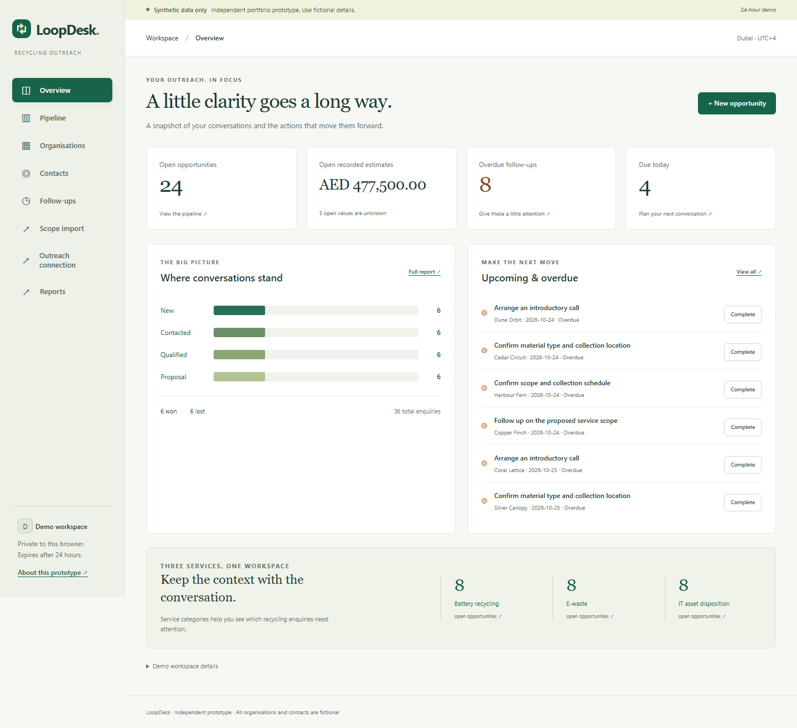

# LoopDesk

Latest local checkpoint, 26 October 2026: **121 automated checks pass** with the additive FollowDesk connection. Migration `005_followdesk` adds one-use pairing, expiring/revocable grants and repeat-safe append-only outreach history. FollowDesk runs separately on port 5059; its simulated inbox sends no email. The real three-app journey and a clean offline installation pass locally. See [connection permissions and setup](docs/followdesk-connection.md) and `../followdesk/docs/checkpoint.md`. PostgreSQL and hosted HTTPS remain unverified. Earlier counts below describe prior checkpoints.

Security review, 26 October 2026: **101 automated checks pass**. Fixed oversized-integer crashes, production configuration gaps, reset-cookie replay and resource accumulation; added host/origin checks, persistent request limits and atomic quotas. The 40-check attack browser journey and both original browser workflows pass locally. See [security report](docs/security-review/README.md). Production now requires explicit `LOOPDESK_TRUSTED_HOSTS` in addition to PostgreSQL and a random session secret. Reset revokes the previous workspace cookie; retained data awaits expiry cleanup. Earlier release counts below are historical.

ScopeDesk integration added 26 October 2026: **Scope import** previews a reviewed, SHA-256-checked JSON file (48 KiB maximum), then explicitly maps existing organisation/contact records and an owner. A first import creates an IT asset disposition opportunity at New with an unknown estimate. Repeating the latest identical revision is idempotent; a newer revision attaches immutable scope history to the existing opportunity and preserves its CRM fields. Conflicting content for the same revision and revisions older than the latest received are rejected. Offline import cannot detect a newer revision that has never been exported. Apply additive migration `002_scopedesk.sql` with the usual launcher/migrate command.

The updated SQLite suite has **71 passing checks**, including the original 51; the original 20 browser checks and ten automated accessibility scans were rerun successfully. The additional two-application journey and 11 new scans are recorded in `../scopedesk/artifacts/`. ScopeDesk runs separately on port 5058 with cookie `scopedesk_session`; LoopDesk retains port 5055 and cookie `session`. PostgreSQL and hosted execution remain unverified. The original project description and earlier evidence below remain applicable to the CRM features.

A recycling outreach CRM: retain an enquiry, connect the right person, give it a next action, and see the pipeline clearly.

Independent portfolio prototype inspired by the Software / Platform Development Intern opportunity at Madenat Al Nokhba Recycling Services LLC. This is a proposed workflow, not a claim about the company's existing systems. No company commission, affiliation, adoption, production use or efficiency improvement is claimed.



## Try it locally

On this Windows machine, open `Start-LoopDesk.cmd` from `D:\codex\loopdesk`, or run `.venv/Scripts/python scripts/manage.py run`. The launcher stores temporary files and caches below the project on D:. Existing Python/browser installations on C: are only used as tools; no new installer or browser download is needed. An independently checked `LoopDesk-Windows-Offline.zip` is also prepared on D: with the matching cached Windows x64/Python 3.14 wheels. Extract its `loopdesk` folder to D: and open the launcher. It is a local application, not a hosted deployment.

Python 3.12 or later is required; verified here with Python 3.14 on Windows. The application has no frontend build step.

```powershell
cd D:\codex\loopdesk
python -m venv .venv
.venv/Scripts/python -m pip install -r requirements-dev.txt
.venv/Scripts/python -m flask --app app migrate
.venv/Scripts/python app.py
```

Open http://127.0.0.1:5055 and choose **Try demo**. Or run `./scripts/run-local.ps1` after setup if your PowerShell policy permits scripts. If scripts are disabled, use the explicit Python commands above; no policy change is necessary. On macOS/Linux, replace `.venv/Scripts/python` with `.venv/bin/python`.

The development default stores SQLite and a randomly generated persistent session secret under the ignored `instance/` directory. Set `DATABASE_URL` and `SECRET_KEY` in the process environment to override these. `.env.example` documents the values; the app does not silently load an `.env` file. The development server listens only on loopback.

In this network-restricted build environment, runtime and test dependencies were installed from already cached wheels. An ignored `.local/wheels/` directory permits an offline reinstall on this Windows/Python version:

```powershell
.venv/Scripts/python -m pip install --no-index --find-links .local/wheels -r requirements-dev.txt
```

The source archive excludes cached wheels and the virtual environment. A normal internet connection is required to install its pinned packages on another machine.

## Three-minute demonstration

1. Start a demo. Explore the overview, then create an organisation and a fictional contact such as `alex@example.com`.
2. Add an opportunity linked to both. Choose Battery recycling, E-waste or IT asset disposition, an owner, a stage and a next action. Leave the estimate blank if unknown.
3. Add a follow-up and a conversation note. Edit the opportunity to move its stage; inspect its history.
4. Open Follow-ups and complete a task. Open Reports to see the current snapshot and its definitions.
5. Filter Pipeline by organisation/title and stage, then export the current view. Board and list share the filters.

The [captioned WebM demo recording](artifacts/LoopDesk-Demo.webm) is a short real browser demonstration, with presentation captions added during capture. [Chapter timings](artifacts/demo-chapters.json) describe the presentation. Open the WebM in a current browser or media player. Data and browser workspaces in recordings are entirely fictional. No MP4 was produced because the available recording encoder supports WebM only.

## What works

- Organisations and contacts: create, edit, search, filter, archive and restore. Linked history is retained.
- Opportunities: relational organisation/contact validation, service, free-text owner, current stage, optional AED estimate and next action. Default stages: New → Contacted → Qualified → Proposal → Won/Lost. Stage changes can move in either direction, because this is an exploratory prototype, not an approved company process.
- Activity notes, transactional edit records and dedicated stage-change events.
- Dated follow-ups; open, overdue, due-today and completed views; complete and reopen.
- Dashboard and reports; filtered opportunity CSV with spreadsheet formula neutralisation.
- Responsive board/list layouts, labelled native forms, visible focus states, skip navigation and useful empty/error states.
- A public overview and isolated signed-cookie workspaces that expire after 24 hours. Expired data is deleted on the next demo creation, so expiry is an access cutoff rather than a guarantee of immediate physical deletion. Reset starts a new workspace; the previous one remains until expiry and cleanup.

## Architecture

`app.py` exports a Flask WSGI application. `loopdesk/__init__.py` handles pages, CSRF, signed sessions and configuration. Jinja renders HTML; a few lines of JavaScript narrow the contact selector. Every relationship is independently checked by the server, so the core workflow also works without JavaScript.

`loopdesk/services.py` contains validation, workspace-scoped queries, business operations, optimistic locking, audit history, report formulas and export. `loopdesk/db.py` wraps SQLite and psycopg DB-API connections. Values use bound parameters; internal table and field identifiers come from application code. Forward-only SQL migrations are applied explicitly through the `migrate` CLI command and tracked in `schema_migrations`.

The implementation uses a small SQL repository layer instead of the planned SQLAlchemy/Alembic stack: those packages were absent from the offline cache, while Flask and psycopg were available. This deviation is deliberate and documented; no ORM or Alembic migration claim is made. SQL migrations and their foreign-key constraints are the schema source of truth.

Organisations, contacts, opportunities, activities, tasks and stage events all reference a workspace. Composite foreign keys prevent cross-workspace and mismatched organisation/contact links in storage. Updates match the submitted integer version and increment it atomically. Failed commands roll back both the business write and its audit entries. Timestamps are UTC ISO strings; follow-up dates are calendar dates interpreted in `Asia/Dubai`.

## Reporting rules

| Metric | Definition |
| --- | --- |
| Open opportunities | Current stage in New, Contacted, Qualified or Proposal. |
| Open by service | Open count grouped into the three prototype categories. |
| Overdue | Incomplete task due before today's Dubai calendar date. Tasks on closed opportunities remain due until completed. |
| Due today | Incomplete task with today's Dubai calendar date. |
| Won / Lost | Counts currently in the respective stage; not a conversion rate. |
| Recorded estimates | Sum of known integer minor-unit values, displayed in AED. Unknowns are counted separately; zero remains zero. Won estimates are not recognised revenue. |
| Archived relationships | Removed from default organisation/contact lists and blocked for new links; existing opportunities and report counts remain. |

The seed creates 30 fictional organisations, 30 contacts, 36 opportunities and 24 follow-ups. Initial totals: 24 open, six Won, six Lost. Addresses use reserved example domains. Due dates are relative to the day the workspace is created.

## Verification

```powershell
.venv/Scripts/python scripts/manage.py test
# Equivalent with a fresh writable test directory:
.venv/Scripts/python -m pytest -q --basetemp=.local/pytest-manual --junitxml=artifacts/pytest.xml
```

51 automated checks cover the SQLite HTTP journey, database restart persistence, relational constraints, stale commands, rollback, cross-workspace read/write denial, expiry cleanup, CSRF, stored HTML escaping, formula-safe export, filtered export reconciliation, empty/unknown values, Dubai midnight boundaries and redacted database-outage responses.

For a dedicated PostgreSQL test database, set `LOOPDESK_TEST_DATABASE_URL` in the process environment and run `.venv/Scripts/python scripts/manage.py test-postgres`. Every business fixture creates and later drops only its own unique `loopdesk_test_…` schema. It does not reset `public` or any existing application schema. The current local run has no PostgreSQL server connection, so this path is prepared rather than verified. `.github/workflows/checks.yml` defines SQLite and PostgreSQL service-container jobs for a future repository; those jobs have not run remotely.

Browser verification requires Node.js and Chromium:

```powershell
npm install
npx playwright install chromium
# Start the Flask server first.
npm run test:browser
npm run record
```

Browser dependencies are pinned in `package.json`. The local run reused the workspace's existing matching Playwright and axe installation via `LOOPDESK_BROWSER_PACKAGE`; no network install was performed. The browser script records 20 explicit journey checks and ten axe scans across desktop and mobile. Automated axe results cover detectable issues only; they are not a full accessibility certification. See [verification evidence](docs/verification.md).

## Hosting status and limitations

The application includes a Vercel Flask entrypoint, `vercel.json`, public assets, production configuration guards and a PostgreSQL connection path. **It is not deployed. PostgreSQL execution is unverified.** Vercel project creation was rejected because the current connection lacks team access. There is no provisioned database or project identity to link. See the [deployment runbook](docs/deployment.md) for the remaining steps and release gate.

Publication was authorised by the user on 25 October. Account access remains a separate provider requirement. A new Vercel authorization request was issued; Neon provisioning tools are available after the user connects Neon. The prepared `scripts/prepare-deployment.py` emits an allowlisted, checksum-recorded API payload containing only runtime code, assets, migrations and dependency configuration. It sends nothing by itself and excludes the private application package.

Production refuses SQLite or an absent/short secret and enables Secure cookies and HSTS. The public demo has a 250 active-workspace capacity guard. Creation-time cleanup is opportunistic. There is no per-visitor rate limiter, staff authentication, account recovery, durable user identity, background cleanup worker, backups or operational monitoring. Signed sessions isolate a short-lived fictional demonstration; this is not a real-customer CRM. A shared cookie/browser means a shared workspace.

No email sending, scraping, company integrations, battery safety assessment, carbon-impact estimates or AI features are included. Contacts have a basic email syntax check; the application does not deliver or verify mail. No safety or disposal guidance is offered. No real company data should be entered.

The `private/` folder contains the application CV and private opportunity notes and is excluded from Git, Vercel and the publication source archive. Public source artifacts contain only synthetic examples. No application has been submitted and no messages have been sent.
