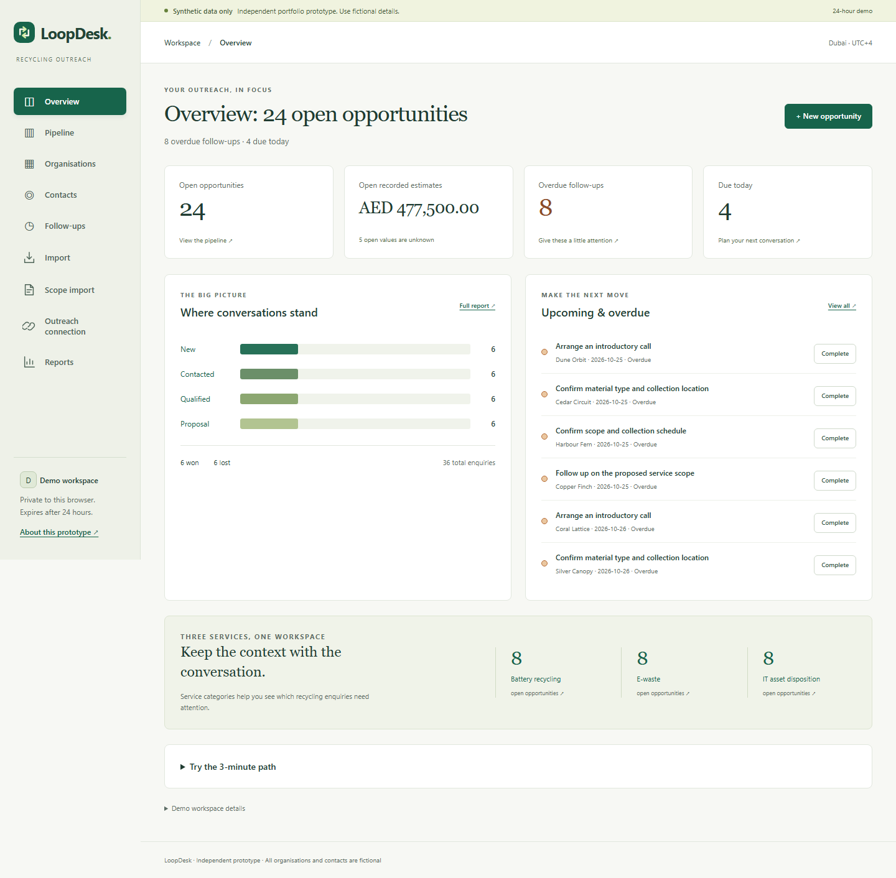
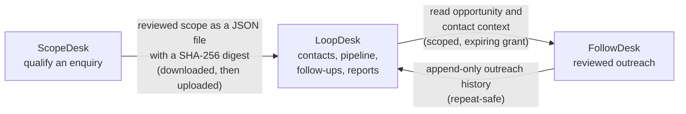

# LoopDesk

A recycling-sales CRM prototype: keep each enquiry, the right contact and a dated next action together, then read the pipeline, follow-ups and reports.

**Live demo:** <https://loopdesk-sigma.vercel.app>. Choose **Try demo** for a private 24-hour workspace of fictional data; no sign-up. One of three connected apps: [ScopeDesk](https://github.com/f20230125-sudo/scopedesk) qualifies an enquiry ([live](https://scopedesk-chi.vercel.app)), **LoopDesk** tracks it and [FollowDesk](https://github.com/f20230125-sudo/followdesk) follows up ([live](https://followdesk-phi.vercel.app)).

[](https://github.com/f20230125-sudo/loopdesk/actions/workflows/checks.yml) [](https://github.com/f20230125-sudo/loopdesk/actions/workflows/live-smoke.yml)

**Stack:** Python (Flask) and Jinja, a small SQL repository layer with forward-only migrations, SQLite locally and PostgreSQL (Neon) when hosted, no frontend build step. Hosted on Vercel and Neon, both on free plans.

Independent portfolio prototype inspired by the Software / Platform Development Intern opportunity at Madenat Al Nokhba Recycling Services LLC. This is a proposed workflow, not a claim about the company's existing systems. No company commission, affiliation, adoption, production use or efficiency improvement is claimed.



## How the three apps fit together

Each app has its own server, database and session cookie. They are joined only by two narrow, explicit contracts.



The scope handoff creates or updates one opportunity and never overwrites CRM fields. FollowDesk's grant comes from a one-use pairing code created in LoopDesk; it cannot create CRM records or change stage, owner, value, next action or tasks.

## Try it locally

On this Windows machine, open `Start-LoopDesk.cmd` from `D:\codex\loopdesk`, or run `.venv/Scripts/python scripts/manage.py run`. The launcher stores temporary files and caches below the project on D:. Existing Python/browser installations on C: are only used as tools; no new installer or browser download is needed. An independently checked `LoopDesk-Windows-Offline.zip` is also prepared on D: with the matching cached Windows x64/Python 3.14 wheels. Extract its `loopdesk` folder to D: and open the launcher. It also runs hosted (see Hosting above); the offline package is for local use.

Python 3.12 or later is required; verified here with Python 3.14 on Windows. The application has no frontend build step.

```powershell
cd D:\codex\loopdesk
python -m venv .venv
.venv/Scripts/python -m pip install -r requirements-dev.txt
.venv/Scripts/python -m flask --app app migrate
.venv/Scripts/python app.py
```

Open http://127.0.0.1:5055 and choose **Try demo**. Or run `./scripts/run-local.ps1` after setup if your PowerShell policy permits scripts. If scripts are disabled, use the explicit Python commands above; no policy change is necessary. On macOS/Linux, replace `.venv/Scripts/python` with `.venv/bin/python`.

The development default stores SQLite and a randomly generated persistent session secret under the ignored `instance/` directory. Set `DATABASE_URL` and `SECRET_KEY` in the process environment to override these. `.env.example` documents the values; the app does not silently load an `.env` file. The development server listens only on loopback.

In this network-restricted build environment, runtime and test dependencies were installed from already cached wheels. An ignored `.local/wheels/` directory permits an offline reinstall on this Windows/Python version:

```powershell
.venv/Scripts/python -m pip install --no-index --find-links .local/wheels -r requirements-dev.txt
```

The source archive excludes cached wheels and the virtual environment. A normal internet connection is required to install its pinned packages on another machine.

## Three-minute demonstration

1. Start a demo. Explore the overview, then create an organisation and a fictional contact such as `alex@example.com`.
2. Add an opportunity linked to both. Choose Battery recycling, E-waste or IT asset disposition, an owner, a stage and a next action. Leave the estimate blank if unknown.
3. Add a follow-up and a conversation note. Edit the opportunity to move its stage; inspect its history.
4. Open Follow-ups and complete a task. Open Reports to see the current snapshot and its definitions.
5. Filter Pipeline by organisation/title and stage, then export the current view. Board and list share the filters.

The [captioned WebM demo recording](artifacts/LoopDesk-Demo.webm) is a short real browser demonstration, with presentation captions added during capture. [Chapter timings](artifacts/demo-chapters.json) describe the presentation. Open the WebM in a current browser or media player. Data and browser workspaces in recordings are entirely fictional. No MP4 was produced because the available recording encoder supports WebM only.

## What works

- Organisations and contacts: create, edit, search, filter, archive and restore. Linked history is retained.
- **Import**: UTF-8 CSV upload → explicit column mapping → row-by-row review → explicit confirmation. Existing fields only: organisation name, sector, city, contact name, email and role. Organisation-only rows are supported; phone and notes have no CRM field and remain unmapped. Download a fictional example from the Import page. See the limits and matching rules below.
- Opportunities: relational organisation/contact validation, service, free-text owner, current stage, optional AED estimate and next action. Default stages: New → Contacted → Qualified → Proposal → Won/Lost. Stage changes can move in either direction, because this is an exploratory prototype, not an approved company process.
- Activity notes, transactional edit records and dedicated stage-change events.
- Dated follow-ups; open, overdue, due-today and completed views; complete and reopen.
- Dashboard and reports, including inactivity, stage age, recent stage changes and completed/due follow-ups; filtered opportunity CSV with spreadsheet formula neutralisation.
- Responsive board/list layouts, labelled native forms, visible focus states, skip navigation and useful empty/error states.
- A public overview and isolated signed-cookie workspaces that expire after 24 hours. Expired data is deleted on the next demo creation, so expiry is an access cutoff rather than a guarantee of immediate physical deletion. Reset starts a new workspace; the previous one remains until expiry and cleanup.

## Spreadsheet import rules

CSV limits are 256 KiB, 500 data rows (including blank rows), 20 columns and 2 KiB of UTF-8 per cell, including headers. UTF-8 BOM is accepted. Empty/duplicate headers, invalid encoding, malformed quoting, control characters and exceeded file/parser limits receive clear rejections. Preview row numbers identify each record's starting physical line, including quoted multiline records. Row width, required values, field lengths and email syntax are checked per row. New organisations require sector and city; contacts require name, email and role. All three contact cells blank means organisation-only.

Organisation names match after trimming and case folding within the workspace; contact emails match the same way. Duplicates in the file and existing records (including archived records) are skipped without updating records. A duplicate contact skips its whole row. New contacts can link to one active matching organisation; ambiguous names or archived organisations reject that row. Preview lists creation, links, skipped duplicates, blank rows and rejection reasons. Only ready rows are confirmed.

Confirmation locks the workspace, rechecks the plan, preflights organisation/contact/audit quotas and writes every ready record plus manual-style creation history in one transaction. Quota failures import nothing. Confirming again returns the saved result and creates nothing, including concurrent submissions. A changed duplicate/link decision requires another mapping review. Previews are workspace-scoped, limited to ten uploads and 2 MiB of uploaded JSON payload per workspace, and deleted with workspace expiry cleanup. Mapped plans are also bounded by the upload/row/cell limits. Unmapped upload cells remain in the temporary preview until cleanup. Text is never evaluated as a formula, leading zeros are preserved as text, and opportunity CSV exports still neutralise formula prefixes. Phone columns are not imported because the schema has no phone field.

## Architecture

`app.py` exports a Flask WSGI application. `loopdesk/__init__.py` handles pages, CSRF, signed sessions and configuration. Jinja renders HTML; JavaScript narrows the contact selector and progressively adds pairing-code copy with a selection fallback. Every relationship is independently checked by the server, so the core workflow also works without JavaScript.

`loopdesk/services.py` contains validation, workspace-scoped queries, business operations, optimistic locking, audit history, report formulas and export. `loopdesk/db.py` wraps SQLite and psycopg DB-API connections. Values use bound parameters; internal table and field identifiers come from application code. Forward-only SQL migrations are applied explicitly through the `migrate` CLI command and tracked in `schema_migrations`.

The implementation uses a small SQL repository layer instead of the planned SQLAlchemy/Alembic stack: those packages were absent from the offline cache, while Flask and psycopg were available. This deviation is deliberate and documented; no ORM or Alembic migration claim is made. SQL migrations and their foreign-key constraints are the schema source of truth.

Organisations, contacts, opportunities, activities, tasks and stage events all reference a workspace. Composite foreign keys prevent cross-workspace and mismatched organisation/contact links in storage. Updates match the submitted integer version and increment it atomically. Failed commands roll back both the business write and its audit entries. Timestamps are UTC ISO strings; follow-up dates are calendar dates interpreted in `Asia/Dubai`.

## Reporting rules

| Metric | Definition |
| --- | --- |
| Open opportunities | Current stage in New, Contacted, Qualified or Proposal. |
| Open by service | Open count grouped into the three prototype categories. |
| Overdue | Incomplete task due before today's Dubai calendar date. Tasks on closed opportunities remain due until completed. |
| Due today | Incomplete task with today's Dubai calendar date. |
| Won / Lost | Counts currently in the respective stage; not a conversion rate. |
| Recorded estimates | Sum of known integer minor-unit values, displayed in AED. Unknowns are counted separately; zero remains zero. Won estimates are not recognised revenue. |
| Inactive open opportunities | At least `STALE_DAYS = 14` elapsed days since creation or the latest activity/edit/stage event. Shows ten oldest, with the full count. Unavailable dates are unknown. |
| Current-stage age | Mean elapsed days from the latest stage event, or creation if no event exists, for each open stage. Empty stages or unavailable dates show Unknown. |
| Recent stage changes | Destination counts for events with a previous stage; initial creation is excluded. Window: Dubai midnight 29 days ago through now (30 calendar dates). |
| Recent completed / due follow-ups | Two separate counts: distinct task IDs in completion audit entries in that window, including tasks subsequently reopened; and tasks with current due dates in that window, regardless of completion. Legacy completion entries without task IDs have unknown attribution and do not become fabricated zeroes. |
| Archived relationships | Removed from default organisation/contact lists and blocked for new links; existing opportunities and report counts remain. |

The seed creates 30 fictional organisations, 30 contacts, 36 opportunities and 24 follow-ups. Initial totals: 24 open, six Won, six Lost. Addresses use reserved example domains. Due dates are relative to the day the workspace is created. New demo workspaces deterministically spread fictional stage/activity history over the preceding 45 days; existing workspaces are not rewritten. Completion and reopening audit entries now include the existing task ID, allowing reliable distinct-task counts without another schema change.

## Verification

```powershell
.venv/Scripts/python scripts/manage.py test
# Equivalent with a fresh writable test directory:
.venv/Scripts/python -m pytest -q --basetemp=.local/pytest-manual --junitxml=artifacts/pytest.xml
```

195 automated checks (121 existing and 74 new) cover CSV limits/mapping/duplicates, concurrent single-use confirmation, atomic quota and audit rollback, literal hostile text, workspace isolation, hand-computed pipeline health, unknowns, Dubai window boundaries, metadata, and the SQLite HTTP journey, database restart persistence, relational constraints, stale commands, rollback, cross-workspace read/write denial, expiry cleanup, CSRF, stored HTML escaping, formula-safe export, filtered export reconciliation, empty/unknown values, Dubai midnight boundaries and redacted database-outage responses.

For a dedicated PostgreSQL test database, set `LOOPDESK_TEST_DATABASE_URL` in the process environment and run `.venv/Scripts/python scripts/manage.py test-postgres`. Every business fixture creates and later drops only its own unique `loopdesk_test_…` schema. It does not reset `public` or any existing application schema. The earlier SQLite and PostgreSQL service-container CI checkpoint passed 121 checks. The new 194-test suite has only been run on SQLite locally; PostgreSQL verification is for the lead to run. See `artifacts/ci-verification.json` for exact tested commits and run evidence. Production Neon connectivity remains a separate check.

Browser verification requires Node.js and Chromium:

```powershell
npm install
npx playwright install chromium
# Start the Flask server first.
npm run test:browser
npm run record
```

Browser dependencies are pinned in `package.json`. The local run reused the workspace's existing matching Playwright and axe installation via `LOOPDESK_BROWSER_PACKAGE`; no network install was performed. The browser script now records 36 explicit journey checks and 19 axe scans across desktop and mobile, including JavaScript-disabled CSV import, clipboard denial fallback and keyboard access to Lost at 1440, 1024 and 390 px. Axe scans of import HTML run separately with scripting enabled because axe requires it. New evidence uses `improvement-2026-10-27-*` / `improvement-*-2026-10-27.*` filenames, preserving earlier browser evidence. Before/after captures use 1440×900 and 390×844 viewports, with an additional 1024 px pipeline capture; full-page image heights can exceed the viewport. Automated axe results cover detectable issues only; they are not a full accessibility certification. See [verification evidence](docs/verification.md).

## Hosting status and limitations

**Hosted** at <https://loopdesk-sigma.vercel.app> on Vercel's free Hobby plan with a Neon PostgreSQL database on Neon's free plan (a separate database per app). Production requires PostgreSQL, a random session secret of at least 32 characters and explicit trusted hosts, and enables Secure cookies and HSTS. Migrations are applied explicitly before each deployment (`flask --app app migrate`); `/health` reports `migration_required` until the latest one is present. See the [deployment runbook](docs/deployment.md).

**Hosted checks:** `python scripts/live-smoke.py` creates a demo workspace on the hosted app and checks the health endpoint, security headers, cookie flags, every main page and the 404 page; a weekly GitHub Actions workflow runs it. The browser journey (`scripts/browser-check.mjs`) can be pointed at the hosted app with `LOOPDESK_URL`; results are in [verification](docs/verification.md). Neon suspends an idle database, so the first request after a quiet period can be slower.

Production refuses SQLite or an absent/short secret. The public demo has a 250 active-workspace capacity guard. Creation-time cleanup is opportunistic. There is no staff authentication, account recovery, durable user identity, background cleanup worker, backups or operational monitoring beyond the smoke check. Signed sessions isolate a short-lived fictional demonstration; this is not a real-customer CRM. A shared cookie/browser means a shared workspace.

No email sending, scraping, company integrations, battery safety assessment, carbon-impact estimates or AI features are included. Contacts have a basic email syntax check; the application does not deliver or verify mail. No safety or disposal guidance is offered. No real company data should be entered.

The `private/` folder holds personal application material and is excluded from Git, Vercel and the publication source archive. Public source artifacts contain only synthetic examples.

## Checkpoint history

Newest first, kept as written. Entries dated 26 October 2026 describe the state before the apps were hosted; the hosting section above is current.

Local improvements, 27 October 2026: **195 tests pass on SQLite** (121 existing + 74 new); **36 browser journey checks and 19 axe scans pass** in local Chromium, with no detected accessibility violations. New spreadsheet import maps existing organisation/contact fields, previews each row and confirms once in a transaction. Reports now include pipeline health and explicit unknowns. The hosted deployment ran the same journey on PostgreSQL (36 checks, 19 axe scans, no violations; smoke 19/19); the pull request's PostgreSQL CI job runs the suite. See [the improvement report](artifacts/improvement-report-2026-10-27.md) and [verification details](docs/verification.md). No runtime dependencies were added; apply new forward migration `006_csv_import.sql` locally before using Import. Existing contracts and migrations 001–005 are unchanged.

Python dependency follow-up: the [three-app advisory scan](https://github.com/f20230125-sudo/followdesk/actions/runs/40379579882) checked all 20 pinned runtime/test packages, including conditional platform pins, and reported no known vulnerabilities. The hosted apps are verified separately: see [verification](docs/verification.md).

Earlier checkpoint, 26 October 2026: **121 checks pass on SQLite and PostgreSQL in [Linux CI](https://github.com/f20230125-sudo/loopdesk/actions/runs/40375197884)**. Migration `005_followdesk` adds one-use pairing, expiring/revocable grants and repeat-safe append-only outreach history. FollowDesk runs separately on port 5059; its simulated inbox sends no email. The real three-app browser journey and a clean offline installation pass locally. See [connection permissions and setup](docs/followdesk-connection.md). This checkpoint predates hosting; both were completed on 27 October 2026. Earlier counts below describe prior checkpoints.

Security review, 26 October 2026: **101 automated checks pass**. Fixed oversized-integer crashes, production configuration gaps, reset-cookie replay and resource accumulation; added host/origin checks, persistent request limits and atomic quotas. The 40-check attack browser journey and both original browser workflows pass locally. See [security report](docs/security-review/README.md). Production now requires explicit `LOOPDESK_TRUSTED_HOSTS` in addition to PostgreSQL and a random session secret. Reset revokes the previous workspace cookie; retained data awaits expiry cleanup. Earlier release counts below are historical.

ScopeDesk integration added 26 October 2026: **Scope import** previews a reviewed, SHA-256-checked JSON file (48 KiB maximum), then explicitly maps existing organisation/contact records and an owner. A first import creates an IT asset disposition opportunity at New with an unknown estimate. Repeating the latest identical revision is idempotent; a newer revision attaches immutable scope history to the existing opportunity and preserves its CRM fields. Conflicting content for the same revision and revisions older than the latest received are rejected. Offline import cannot detect a newer revision that has never been exported. Apply additive migration `002_scopedesk.sql` with the usual launcher/migrate command.

The updated SQLite suite has **71 passing checks**, including the original 51; the original 20 browser checks and ten automated accessibility scans were rerun successfully. The additional two-application journey and 11 new scans are recorded in `../scopedesk/artifacts/`. ScopeDesk runs separately on port 5058 with cookie `scopedesk_session`; LoopDesk retains port 5055 and cookie `session`. That checkpoint predates PostgreSQL CI and hosting; both are now verified (see Hosting above). The original project description and earlier evidence below remain applicable to the CRM features.
